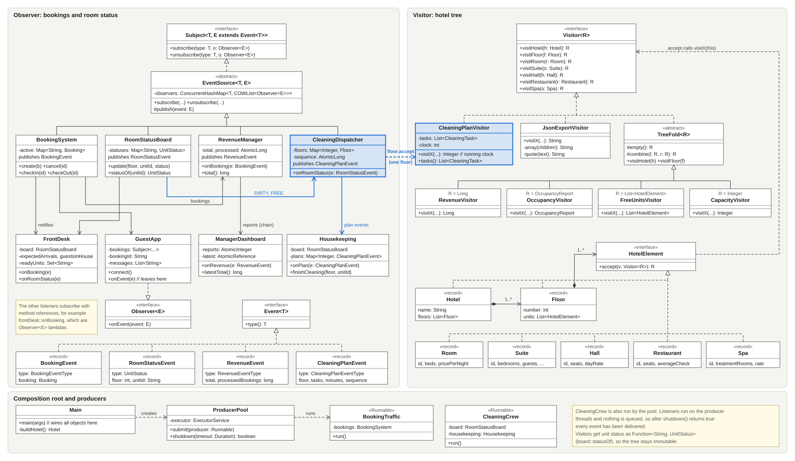

# Hotel management (Assignment 6, variant 20)

Bookings and room status changes notify the hotel staff (Observer). The hotel itself is a fixed tree of floors and units, and reports are added as visitors (Visitor). When a room gets dirty, the cleaning plan is recalculated for that floor only and sent to housekeeping.

Java 17, JUnit 5, no other libraries.

```
mvn test
java -cp target/classes hotel.Main 4 200
```

`Main` takes the number of producer threads and the number of bookings per producer. Defaults are 4 and 200.

## UML



## Observer

Subjects: `BookingSystem`, `RoomStatusBoard`, plus `RevenueManager` and `CleaningDispatcher`, which are listeners and subjects at the same time.

Listeners: `FrontDesk`, `GuestApp`, `RevenueManager`, `ManagerDashboard`, `Housekeeping`, `CleaningDispatcher`.

The chain is `BookingSystem -> RevenueManager -> ManagerDashboard`. `RevenueManager` adds up the money and publishes a report every N bookings, and once when the target is reached.

**Push, not pull.** The event carries everything the listener needs. With pull the listener would ask the subject for data after being notified, and on a busy system that data could already belong to a newer event. Immutable records can be passed between threads without any care, and listeners don't need a reference to the subject (`GuestApp` has one only because it subscribes and leaves by itself).

**Registry.** `EventSource` keeps a `ConcurrentHashMap` from event type to `CopyOnWriteArrayList`. `publish` takes no lock, so one slow listener doesn't block other publishers.

What happens if a listener unsubscribes while other threads publish: the removal is safe and nobody gets `ConcurrentModificationException`, because each publish walks over its own snapshot. A publish that started before the removal can still deliver one last event to that listener. I left it this way, because preventing it would need a lock around every delivery. `GuestApp` shows joining and leaving inside a handler: it subscribes to check-out when the guest checks in and unsubscribes when the stay ends.

If a listener throws, the exception is logged and the other listeners still get the event.

## Visitor

The tree is `Hotel -> Floor -> Room, Suite, Hall, Restaurant, Spa`. All elements are records, the only method they have is `accept`.

| Visitor | Kind | Result |
|---|---|---|
| `RevenueVisitor` | numeric | income for today |
| `CleaningPlanVisitor` | keeps state over the tree | tasks with start times from one running clock |
| `FreeUnitsVisitor` | filter | units that can be sold to a group of a given size |
| `JsonExportVisitor` | export | hand-written nested JSON |
| `OccupancyVisitor` | report | occupied and total units |
| `CapacityVisitor` | numeric | how many guests can sleep in the hotel |

**The visitor does the traversal.** The JSON export has to write brackets around the children and the cleaning plan has its own order, so a walk fixed inside the tree wouldn't fit them without extra hooks. It also keeps `accept` one line long, so elements stay data. To avoid repeating the same loop, visitors that only add up leaf results extend `TreeFold`.

**Why not `visitor.visit(node)`.** With a `HotelElement` variable the compiler doesn't know the real class, and overloads are chosen at compile time. `unit.accept(visitor)` picks the element by its runtime class (first dispatch). Inside, `visitor.visitRoom(this)` picks the visitor by its runtime class (second dispatch).

**Status is not in the tree.** Room status changes all the time and the tree shouldn't. Status lives in `RoomStatusBoard`, and visitors get it as `Function<String, UnitStatus>`. That is why the tree needs no synchronization, and tests can give any status they want with a simple map.

## Integration

```
FrontDesk gets CHECKED_OUT -> board.update(DIRTY) -> RoomStatusEvent
  -> CleaningDispatcher runs CleaningPlanVisitor on that Floor only
  -> CleaningPlanEvent -> Housekeeping
```

Two threads can finish plans for the same floor in the wrong order, so the older plan could overwrite the newer one. To prevent this the dispatcher takes a sequence number before reading the statuses, and `Housekeeping` keeps the plan with the highest number. That plan has seen every status change that came before it.

## Concurrency

`ProducerPool` wraps a fixed `ExecutorService` with a configurable thread count. Producers are `BookingTraffic` (one per thread) and `CleaningCrew`.

Listeners run on the producer's thread and there is no queue between them, so when a producer is finished, its events are delivered. `shutdown` stops new tasks and waits for the running ones. If the timeout passes, it interrupts them and returns false, so no thread stays hanging.

Shared state is only in concurrent collections and atomics. `CleaningPlanVisitor` is not thread-safe, but a new instance is made per run.

## Clean Code

- `Main` is the only composition root, everything else gets its dependencies through the constructor.
- No lazy initialization in business code.
- `Subject` exists because `GuestApp` should only see subscribe and unsubscribe, not `publish` or the booking methods.
- Money is in whole currency units (`long`), so results don't have rounding errors.

## Trade-off proof

**New visitor, commit `6423792`:** 2 new files, no existing file changed.

- `src/main/java/hotel/visitor/CapacityVisitor.java` (new)
- `src/test/java/hotel/visitor/CapacityVisitorTest.java` (new)

**New element, commit `30a66cf`:** 2 new files and 8 changed.

- `src/main/java/hotel/tree/Spa.java` (new)
- `src/test/java/hotel/visitor/SpaTest.java` (new)
- `src/main/java/hotel/visitor/Visitor.java`
- `src/main/java/hotel/visitor/RevenueVisitor.java`
- `src/main/java/hotel/visitor/OccupancyVisitor.java`
- `src/main/java/hotel/visitor/FreeUnitsVisitor.java`
- `src/main/java/hotel/visitor/CleaningPlanVisitor.java`
- `src/main/java/hotel/visitor/JsonExportVisitor.java`
- `src/main/java/hotel/visitor/CapacityVisitor.java`
- `src/main/java/hotel/Main.java` (only to put a spa in the sample hotel)

**Cost.** A new operation is one class. A new element type means changing the interface and every visitor, and the cost grows with each visitor. The good side is that the compiler lists all the places, because `Visitor` has no default methods. For a hotel this is fine, since new kinds of units are rare and new reports are common. If the element types changed often, I wouldn't use Visitor.

## Tests

63 tests, run with `mvn test`:

- Stress test: 4 threads x 1000 events, exactly 4000 received, also through the revenue chain (exactly 40 reports, total 40000).
- Listeners joining and leaving while 4 threads publish.
- Housekeeping keeps the freshest plan (repeated 20 times).
- A stuck producer gets interrupted on shutdown.
- Visitor results are checked against values counted by hand, the calculation is in the comments of `VisitorsTest`.
